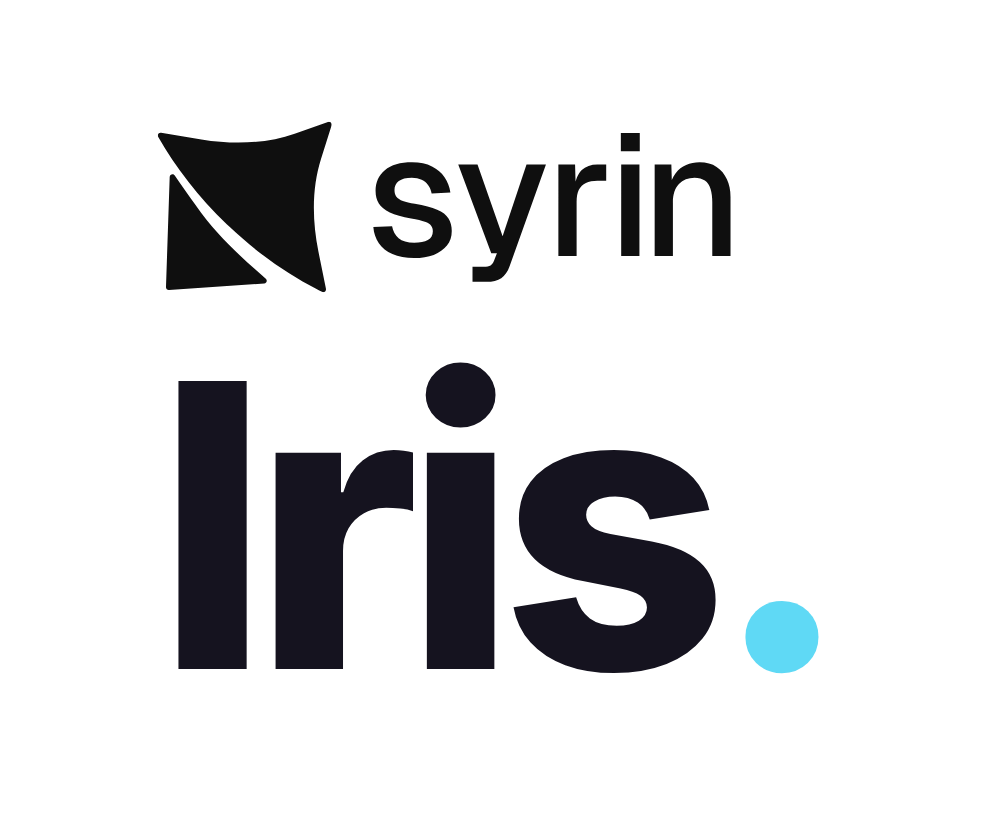
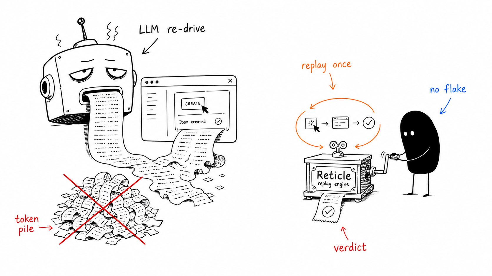
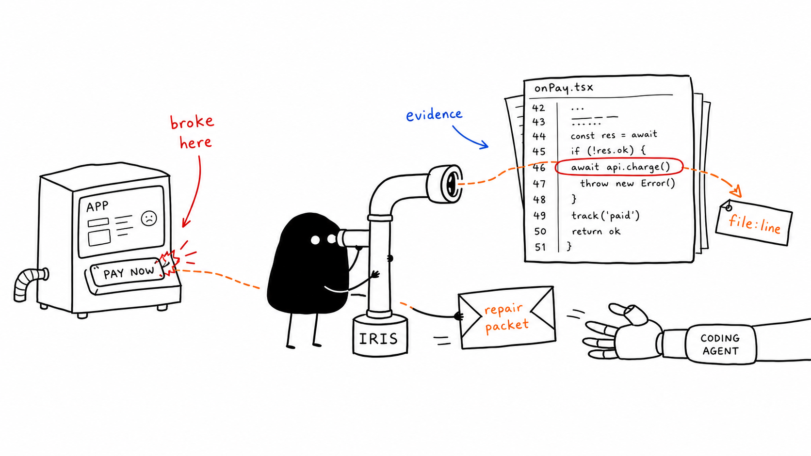
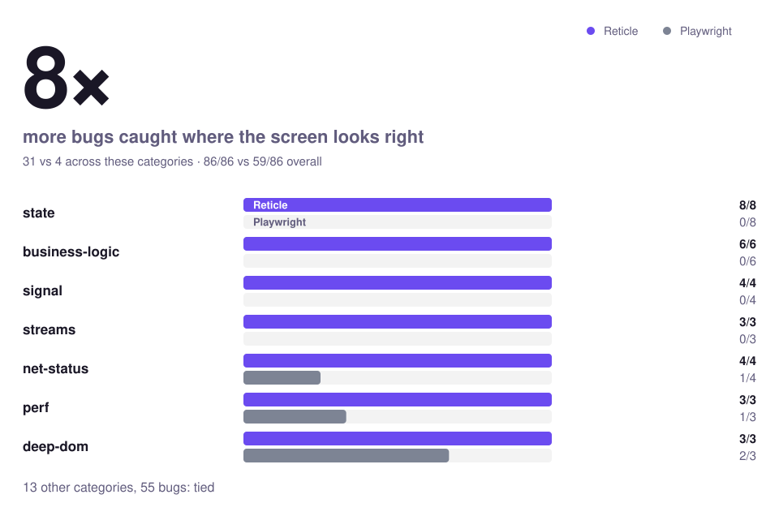
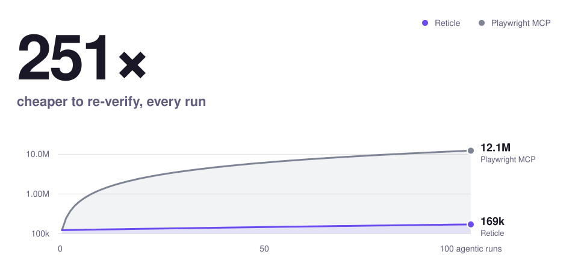
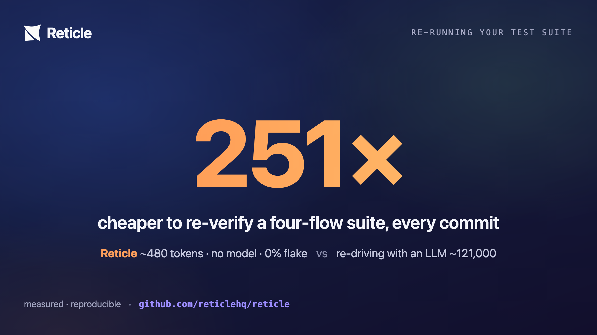
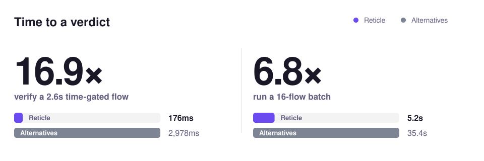

<div align="center">

<picture>
  <source media="(prefers-color-scheme: dark)" srcset="assets/readme/lockup-on-dark.png" />
  
</picture>

<br/>

**Your AI agent says "done." Reticle finds out if that is true.**

It drives your real, running app and reads what happened. Then it returns a verdict, **pass · fail · cannot tell**, with the `file:line` to fix.

[](https://www.npmjs.com/package/@reticlehq/server) [](https://www.npmjs.com/package/@reticlehq/core) [](https://github.com/reticlehq/reticle/stargazers) [](LICENSE) [](https://securityscorecards.dev/viewer/?uri=github.com/reticlehq/reticle) [](https://discord.gg/BwAbzv9ZRz)

[**Quick start**](#quick-start) · [Why Reticle](#why-reticle) · [What it does](#what-it-does) · [The computer](#the-computer-any-application-on-the-desktop) · [Benchmarks](#benchmarks) · [Commands](#commands) · [Safe to install](#safe-to-install) · [Docs](https://docs.reticle.sh)

[⭐ Star the repo](https://github.com/reticlehq/reticle/stargazers) · [Good first issues](https://github.com/reticlehq/reticle/labels/good%20first%20issue) · [Contribute](CONTRIBUTING.md)

<!-- An animated image, because GitHub strips iframes and no embedded player can autoplay here. Mux
     serves at most 10 seconds as a GIF; the link opens the full video. -->
<a href="https://player.mux.com/ap7hnnu4j36BRV6wEcop1NZVpJTjVSedxpW1AaXdD3I?metadata-video-title=reticle%27s+demo+&video-title=reticle%27s+demo+">
  
</a>

<sub>▶ An agent says its fix works. Reticle catches the double charge it missed. Click for the full demo.</sub>

</div>

---

## Quick start

You need Node 20.11+ and a web app that runs locally. The full guide is [docs.reticle.sh/quickstart](https://docs.reticle.sh/quickstart).

**1. Check your app, with nothing installed.** In your app's folder:

```bash
npx @reticlehq/server
```

It finds your dev server (or starts it), opens the app, and checks that pages load with no console error and no failed request. It changes no file. It ends in a verdict:

```text
  ✗ Console error on /broken: Uncaught Error: status page broke
  ✗ Failed request on /broken: GET http://localhost:58473/api/missing: HTTP 404
verified: no — 2 fault(s) on http://localhost:58473/
```

**2. Connect your coding agent** (once per project):

```bash
npx @reticlehq/server init            # add --dry-run to see the plan first
```

It adds the dev-only SDK to your app and registers Reticle with every coding agent on this machine. A dev server that was already running must restart once.

**3. Restart your agent, and ask for one real journey:**

> _"Verify the sign-up flow with Reticle."_

The agent clicks and types through Reticle, and gets a verdict with its evidence and the line to fix:

```jsonc
{
  "verified": "no",
  "failureReason": "POST /api/signup returned 500",
  "source": "src/SignUp.tsx:42",
}
```

A verdict, `yes`, `no` or `unknown` (cannot tell), means the install is finished. Stuck? Run `npx @reticlehq/server doctor`, or see [Troubleshooting](https://docs.reticle.sh/troubleshooting).

<details>
<summary>What <code>reticle init</code> changes, file by file</summary>

<br/>

It detects your framework, then:

1. **Installs two dev dependencies**, at the same version as the CLI: the SDK (`@reticlehq/react` on a React app, the framework-neutral `@reticlehq/browser` on Vue, Svelte and other stacks) and the build plugin (`@reticlehq/vite-plugin`, or `@reticlehq/next` for Next.js).
2. **Writes `.reticle.json`**: `{ "framework", "projectId", "port" }`. The `projectId` keeps two apps running at once apart. The `port` is the local bridge that the app dials. `init` writes it only when it is not the default 4400 (that one was taken).
3. **Adds the plugin to your build config** (one import and one entry), which injects the connect call in development only.
4. **Writes the dev module, `reticle-dev`** (below).
5. **Writes agent instructions**, so every agent in this repo knows to verify with Reticle. A short rule goes in `CLAUDE.md` and `AGENTS.md` (appended, never overwritten), the full rules in `RETICLE.md`, and a `/reticle` command in `.claude/commands/reticle.md`. `--no-mcp` skips these files and agent registration.
6. **Installs a prompt hook** for each agent it finds that has one: one entry in that agent's project config, such as `.claude/settings.json` or `.cursor/hooks.json`. The hook runs `reticle hook prompt`, which keeps each prompt, redacted, in `.reticle/request.json` and `.reticle/requests.jsonl`. `--no-prompt-capture` skips it. [Prompt capture](docs/prompt-capture.md) has the full list and every switch.
7. **Starts your dev server** if none is running, **opens the app**, and **waits until it connects**. That connection is what `init` verifies. It never drives your app. Verifying a flow is the next step.

This is what it writes for the two most common setups, recorded from runs on fresh templates. [Frameworks](docs/frameworks.mdx) has the other frameworks:

|  | Vite (React, Vue, Svelte…) | Next.js (App Router) |
| --- | --- | --- |
| Dev dependencies | `@reticlehq/react` (Vue, Svelte: `@reticlehq/browser`), `@reticlehq/vite-plugin` | `@reticlehq/react`, `@reticlehq/next` |
| Build config | `vite.config.ts`: `plugins: [reticle(), react()]` (`reticle({ port: N })` only when port 4400 was taken) | `next.config.ts`: `export default withReticle(nextConfig)` |
| Dev module | `src/reticle-dev.ts`, loaded by the plugin's injected connect | `app/reticle-dev.tsx`, a client component that connects after hydration |
| Mounted in | nothing to mount | `app/layout.tsx`: `{process.env.NODE_ENV === 'development' ? <ReticleDev /> : null}` |
| Project config | `.reticle.json` | `.reticle.json` |

**You edit the `reticle-dev` file.** It is dev-only: it tests `import.meta.env.DEV` (Next.js: `NODE_ENV === 'development'`), so it does nothing in a production build. Here you tell Reticle what your app holds. At first, it registers nothing:

```ts
// src/reticle-dev.ts: written by `reticle init`. You never import it; the plugin loads it.
import { registerCapabilities, registerStore } from '@reticlehq/react';
import { useApp } from './store';

if (import.meta.env.DEV) {
  registerStore('app', useApp); // pass the STORE, not () => store.getState(): the store form sees every change
  registerCapabilities({
    testids: ['login-submit', 'cart-total'], // the data-testid values your key flows touch
    signals: ['order:saved'], // names you emit with reticle.signal() where a thing really succeeds
    stores: ['app'],
  });
}
```

The store registration is the most valuable line. It lets the agent verify what the app **believes**, not only what it rendered. You do not need it on day one, because Reticle already reads the DOM, network and console. Start with the store your most important flow reads ([Instrument your app](https://docs.reticle.sh/instrumentation)).

**Read the marks `init` prints.** `✓` done · `·` already in place · `–` skipped by a flag · `⚠` **could not be done, with the exact fix printed** · `ℹ` **done but incomplete, read it**. If you skip a `⚠` or `ℹ`, a "green" install can still find nothing.

**More flags:**

```bash
npx @reticlehq/server init --env KEY=VALUE    # something the app needs to boot (repeatable)
npx @reticlehq/server init --files-only       # write the files, don't boot the app
npx @reticlehq/server init --json             # one JSON object, for agents
npx @reticlehq/server init --no-mcp           # skip agent registration and rule files
```

**What you commit.** The edits above and your saved flows in `.reticle/flows/`, so a teammate or CI can replay them. The rest of `.reticle/` stays local, because session journals hold request bodies and page text. Reticle writes a `.reticle/.gitignore` that keeps it out of git.

**Undoing it.** Run `reticle hook uninstall`. Revert the other edits that `init` listed, including the lines it appended to `CLAUDE.md` and `AGENTS.md`. Remove the two dev dependencies. Delete `.reticle.json`, `.reticle/`, `RETICLE.md`, `.claude/commands/reticle.md`, the `reticle-dev` file and, if init wrote one, `reticle.local.js`. Your production build never contained Reticle.

</details>

<details>
<summary>Other ways to install: the installer, the skill, the Claude Code plugin, any MCP client</summary>

<br/>

**The installer** puts `reticle` on your PATH once per machine and registers Reticle with every coding agent it finds. It does not touch your project. Run it before you open your coding agent: an open agent must restart once to see the new tools.

```bash
curl -fsSL https://raw.githubusercontent.com/reticlehq/reticle/main/install/install.sh | sh
```

Windows (PowerShell):

```powershell
irm https://raw.githubusercontent.com/reticlehq/reticle/main/install/install.ps1 | iex
```

It ends with **Next steps**: restart your coding agent, then paste the prompt that it printed into the agent, opened in your app's folder. The agent runs `init`, drives one real flow to a verdict, and lists every file it changed. To avoid piping a script into your shell, run `npm install -g @reticlehq/server`, then `reticle setup mcp`.

**The skill** (Claude Code, Cursor, Codex, Copilot, Gemini and others) teaches your agent to wire the app and prove one flow:

```bash
npx skills add reticlehq/reticle --skill reticle
```

**On Claude Code, the plugin** registers the tools and the skill: `/plugin marketplace add reticlehq/reticle`, then `/plugin install reticle@reticlehq`. Type `/reload-plugins` and the Reticle tools load in the open session, with no restart. In an app that is not wired, Claude offers a check of the running app with nothing installed, and `init` to keep Reticle wired. Claude runs `init` only when you agree, because `init` changes your files.

It does three things in order, then prints your next steps. It asks you no questions:

1. Checks for Node 20.11 or newer. If Node is missing or too old, it stops and shows the fix.
2. `npm install -g @reticlehq/server`, which puts the `reticle` command on your PATH.
3. `reticle setup install`: registers Reticle's MCP server with every coding agent it finds on this machine (Claude Code, Cursor, Windsurf, VS Code, Zed, Gemini CLI, Copilot CLI, OpenCode, Antigravity, Warp, Kiro, Amazon Q, Cline, Roo Code, Amp, Continue, Factory Droid). Each entry starts the copy that `npm install -g` put on disk, with `node <path>/bin/reticle.js mcp`, so the agent does not wait for a download. If `codex` is on your PATH, the installer registers **Codex CLI** with `codex mcp add`. Reticle then adds one line, `default_tools_approval_mode = "approve"`, under `[mcp_servers.reticle]` in `~/.codex/config.toml`. This line approves Reticle's own tools, so Codex does not ask before each call. Reticle changes no other line, and it keeps a mode that you set. To undo it, change that line to `default_tools_approval_mode = "prompt"`. Reticle does not change a mode that is already there. Without `codex`, the installer names `~/.codex/config.toml` for you to add these lines by hand:

   ```toml
   [mcp_servers.reticle]
   command = "npx"
   args = ["@reticlehq/server", "mcp"]
   ```

At the end, it says that Reticle is **not in your app yet**, and prints a prompt for your coding agent. With no coding agent, run `reticle init` in your app's folder, then press **Run Harness** in the Reticle panel. To see a verdict before you wire anything, run `reticle` with no arguments in your app's folder ([step 1](#quick-start)).

**Any MCP client, by hand:**

```json
{ "mcpServers": { "reticle": { "command": "npx", "args": ["@reticlehq/server", "mcp"] } } }
```

</details>

<details>
<summary>Connect the dashboard (optional)</summary>

<br/>

```bash
reticle connect --project "My App"
```

It opens your browser to sign in or create a free account. Then it links this folder to that project on [app.reticle.sh](https://app.reticle.sh) and sends the runs already on your machine. If the app is not wired yet, it wires it first.

After that, runs sync automatically. To sync now:

```bash
reticle sync            # sync once
reticle sync --watch    # keep syncing while you work
```

**✅ It worked when** `reticle status` shows this folder linked to your project.

> `reticle: command not found`? Every command also works as `npx @reticlehq/server <command>`, for example `npx @reticlehq/server init`.

</details>

<details>
<summary>For agents: the rules during install</summary>

<br/>

The full agent guide is [SKILL.md](SKILL.md). These are the rules that matter most during install:

- `init` changes the user's files. Run it only when the user asked to set up Reticle, or agreed when you offered. Run it in the app's folder. Use `reticle init --json`, so you read one object instead of parsing text. Add `--app <dir>` in a monorepo, and `--env KEY=VALUE` for anything the app needs to start.
- If the dev server was already running when `init` ran, restart it and reload the tab. Until you do, the app serves a bundle without the SDK.
- Run `reticle connect` only if the user asked for the dashboard. A person must approve the sign-in in a browser.
- If the `reticle_*` tools are not in your client, ask the user to run the installer and restart the client. Then stop. If the tools were registered while you were running, `reticle init --relaunch` prints the command that resumes this conversation with them loaded.
- A session listed means the SDK reached the page. Setup is finished when the first run returns a verdict.
- `unknown` is not a pass. Report it as "cannot tell", with the reason Reticle gives.
- Stuck? Run `reticle doctor` and report what it says. To report a problem with Reticle, run `reticle feedback --agent --kind bug "…"`.

</details>

<details>
<summary>Check one fact without an agent</summary>

<br/>

Without an agent, you can verify one fact about the current page from a terminal. It does not click through a flow; that is the agent's job. It exits 0 only on `yes`:

```bash
npx @reticlehq/server verify http://localhost:5173 --expect '{"kind":"element","query":{"role":"heading","name":"Welcome"},"state":"visible"}'
```

PowerShell changes those quotes. On Windows, put the JSON in a file and pass `--expect-file check.json` instead.

</details>

---

## Why Reticle

Your agent writes code, **assumes** it worked, and moves on. It never opens the app. So the silent `500`, the badge that shows the wrong count and the "Deploy succeeded" over a failed deploy all ship, and **you become your agent's QA**.

Playwright, DevTools and browser agents look in from **outside** the browser. For your own app, the important bugs never reach the pixels:

| Bug | Looks fine on screen? | Reticle reads |
| --- | :-: | --- |
| Pay button silently returns `500` | yes | the network response, tied to the click |
| Badge shows "12", the store holds `0` | yes | your app's state |
| The form fired the request twice | yes | request count |
| "Deploy succeeded", the deploy failed | yes | the store's real status |
| A console error slipped in | yes | the console since the action |
| Component re-renders 60×/sec | yes | the React commit stream |

**Use both.** Playwright for sites you do not own, many browsers, real pixels. Reticle for the app you build, inside your agent's loop.

<p align="center">
  
</p>

---

## What it does

A small, **dev-only** SDK in your app gives your coding agent tools to **look, act, observe and assert** from the inside.

- **A verdict, not a screenshot.** `yes`, `no` or `unknown`, with the request, the state change and the console line that decided it, and the `file:line` to open. Only `yes` is a pass.
- **Flows that replay with no AI model.** Say _"save that as a flow"_. One call then re-verifies that journey, so today's fix cannot quietly break last week's feature.
- **A gate in CI.** `npx @reticlehq/server gate --since HEAD~1` fails a change that touches a saved flow without a new passing run ([gate](docs/cli/gate.mdx)).
- **A HUD in your page** shows each action, each verdict and the flows the agent saved.
- **Works with your agent:** Claude Code, Cursor, Codex, Windsurf, VS Code, Gemini CLI and anything that speaks MCP. Web (React, Next.js, Vue, Svelte, Angular and more) and desktop (Electron, Tauri).

You say what should be true, in plain English: _"I changed checkout. Verify it with Reticle before you tell me it is done."_ People also use it for access-control checks, accessibility, performance and SEO: [use cases](https://docs.reticle.sh/use-cases).

<p align="center">
  
</p>

<p align="center">
  
</p>

<details>
<summary><b>What one call looks like underneath</b></summary>

<br/>

```jsonc
// The agent clicked "Pay". Did the right things actually happen?
reticle_assert({
  predicate: { kind: "allOf", predicates: [
    { kind: "net",     method: "POST", urlContains: "/api/order", status: 200 },
    { kind: "element", query: { role: "dialog", name: "Order confirmed" }, state: "visible" },
    { kind: "signal",  name: "order:saved" },          // the charge actually committed
    { kind: "console", level: "error", absent: true }  // …and nothing errored
  ]}
})
// → { verified: "no",
//     because: "the declared consequence did not hold",
//     pass: false,
//     failureReason: "POST /api/order returned 500, expected 200",
//     source: "src/checkout/PayButton.tsx:42" }
```

</details>

---

## The computer: any application on the desktop

A page is not the whole job. A download opens a save dialog, a sign-in opens a popup, and a desktop app has no page at all. `@reticlehq/computer` joins any application on the screen as a Reticle session, and your agent uses the same tools:

```bash
npx -p @reticlehq/computer reticle-computer --app "Notes"
```

- **macOS, Windows and Linux.** It reads the accessibility tree of the operating system (AX, UI Automation, AT-SPI on X11). The application needs no SDK.
- **Proof, not clicks.** Each action reports what it changed: the elements, the files, the settings, the clipboard and the pixels.
- **It acts only where a person can act.** A control that something covers, or that is in a closed menu, is refused with the reason. Actions go in the background, so you keep your pointer and keyboard.
- **The browser and the computer work together.** `reticle_attach_tab` joins a tab of your own Chromium browser, and `reticle_session { action: "board", carry }` carries a value from a desktop app into a page and proves it arrived.

The computer realm is new: your agent can report a problem in one call, `reticle_feedback`. [Its README](adapters/realm/computer/README.md) has every flag and limit.

---

## Benchmarks

An 88-bug registry (86 real regressions, 2 false-positive traps) injected into a controlled app, against a Playwright script. Reproduce it with `node bench/pw-vs-reticle/run.mjs`.

<p align="center">
  
</p>

<p align="center">
  
</p>

Re-verification has no model in the loop, so a recorded suite costs a fixed, small read. Reticle is ahead from the second run, even when it pays for a full LLM drive to write the suite.

<p align="center">
  
</p>

<p align="center">
  
</p>

---

## Commands

Use `reticle <command>` after install, or `npx @reticlehq/server <command>` anywhere. `reticle help all` lists every command.

| Command | What it does |
| --- | --- |
| `reticle init` | Wires the app in this folder. `--dry-run` writes nothing, `--app <dir>` picks one app in a monorepo |
| `reticle open [url]` | Shows your app in a browser connected to Reticle |
| `reticle verify <url>` | Runs your saved flows again. Exits 0 only when every one passes |
| `reticle gate --since HEAD~1` | For CI: fails unless every saved flow your changes touch has a passing run |
| `reticle status` / `reticle doctor` | Whether Reticle runs and which apps are connected / what is wrong, and the fix |
| `reticle connect --project "My App"` | Optional: links this folder to the dashboard on app.reticle.sh |
| `reticle update` | Installs the latest version. `--rollback` goes back |
| `reticle feedback "message"` | Tells us what worked and what did not. It prints exactly what it sends |

---

## Safe to install

- **Dev-only.** Production builds do not include the SDK, and a runtime guard refuses to connect in production.
- **Local.** The bridge listens only on `127.0.0.1`. Nothing from your app leaves your machine unless you link a project. Anonymous usage counts can be turned off with `reticle telemetry disable` ([the complete list](docs/telemetry.md)).
- **Open and signed.** Apache-2.0, published from CI with npm provenance (`npm view @reticlehq/server dist.attestations`), and no install scripts.
- **No `evaluate`.** Reticle never runs arbitrary JavaScript in the page, and it redacts passwords, tokens and card numbers.
- **See the plan first:** `npx @reticlehq/server init --dry-run` writes nothing. Security issue? Follow [SECURITY.md](SECURITY.md).

<details>
<summary>What it touches, and what leaves the machine</summary>

<br/>

| It touches | Why | Scope |
| --- | --- | --- |
| Your app's dev dependencies, build config and one `reticle-dev` file | The SDK has to run inside the page to read network, state and console | Development builds only. Production builds remove it, and a runtime guard refuses to connect in production |
| Your coding agents' MCP config | So your agent gets the `reticle_*` tools | One `reticle` entry that runs the installed copy (`node <path>/bin/reticle.js mcp`) or `npx @reticlehq/server@<version> mcp`; nothing else in the file changes |
| `CLAUDE.md`, `AGENTS.md`, `RETICLE.md`, `.claude/commands/reticle.md` | So any agent in the repo knows to verify its work | Appended, never overwritten; `--no-mcp` skips them |
| A prompt hook in each agent's project config (`.claude/settings.json`, `.cursor/hooks.json`, `.codex/hooks.json`, `.gemini/settings.json`, `.windsurf/hooks.json`, `.github/hooks/reticle-prompt-capture.json`, `.factory/hooks.json`) | So each prompt is kept as the request a verdict is checked against | Only for agents it finds; one entry, merged into what is there; `--no-prompt-capture` skips it, `reticle hook uninstall` removes it |
| A local service on `127.0.0.1:4400` | The bridge between the page and your agent | Loopback only, paired with a token stored owner-only in `~/.reticle/` |
| A Chromium browser | To drive the app | Your own machine |

**What leaves the machine:** nothing from your app (DOM, network bodies, console, state, source) unless you link a project with `reticle connect` (or set `RETICLE_API_KEY` in CI). Verdicts are made locally, with no account. After you link, `reticle config --runs/--memory/--flows on|off` sets what syncs. Each prompt you send to your agent is kept in `.reticle/`, redacted, and a linked project sends it with its runs by default; `"shareRequests": false` in `.reticle.json` keeps prompts on the machine ([Prompt capture](docs/prompt-capture.md)). [What each part contains is written down](docs/what-is-recorded.md). When the Harness drives, the platform sees its steps, but secret field values never leave your machine. Reticle also sends anonymous usage counts by default (which commands and tools ran, with a random id, nothing from your app, and no IP address or location). `reticle telemetry disable`, `RETICLE_TELEMETRY=0` or `DO_NOT_TRACK=1` turns them off, and every other optional outbound call too. [The complete list](docs/telemetry.md).

</details>

---

## Supported, and limits

|  |  |
| --- | --- |
| **Web** | CI drives React + Vite and Next.js to a verdict. CI boots Remix and Astro and checks that each connects. More frameworks are install-gated or wired. **[Frameworks](docs/frameworks.mdx) is the one list of what is proven, and how far** |
| **Desktop** | Electron and Tauri, with the IPC boundary. Any other application through [the computer realm](#the-computer-any-application-on-the-desktop) |
| **Agents** | anything that speaks MCP. Config written automatically for Claude Code, Cursor, Windsurf, VS Code, Zed, Gemini CLI, Copilot CLI, OpenCode, Antigravity, Warp, Kiro, Amazon Q, Cline, Roo Code, Amp, Continue, Factory Droid. Codex CLI through `codex mcp add`, or a four-line paste when `codex` is not on PATH |
| **Browsers** | the SDK runs in the tab you already have open; the tested and driven browser is Chromium, plus Electron and Tauri webviews |
| **State** | zustand and Redux need no adapter. Shipped: TanStack Query, Jotai, XState, Valtio, MobX, Recoil, Svelte stores, Pinia |
| **OS** | macOS, Linux, Windows |
| **Cannot see yet** | IndexedDB, Web Workers, closed shadow roots, cross-origin iframes |

When Reticle cannot see something, it says so: the verdict is `unknown`, with the reason.

---

## The open-source tool, the Harness, and the dashboard

- **The open-source tool** is the full verify loop on your machine: the SDK, the local daemon, the MCP tools and the HUD. It needs no account.
- **The Harness** (optional, on the platform) drives a journey you describe in plain words, verifies each step and saves flows that replay with no model. Start it from **Run Harness** in the HUD ([how it works](docs/autodrive.md)).
- **[app.reticle.sh](https://app.reticle.sh)** shows a team every run, the bugs Reticle caught, saved flows and coverage. Link a folder with `reticle connect`.

---

## Community

[💬 Discord](https://discord.gg/BwAbzv9ZRz) · [Good first issues](https://github.com/reticlehq/reticle/labels/good%20first%20issue) · [Contributing](CONTRIBUTING.md) · [Discussions](https://github.com/reticlehq/reticle/discussions) · [Issues](https://github.com/reticlehq/reticle/issues) · [Book a call with the founders](https://calendar.app.google/h9NRDbBBQetyTzWM6)

Everyone here follows the [Code of Conduct](CODE_OF_CONDUCT.md).

<p align="center">
  <a href="https://github.com/reticlehq/reticle/graphs/contributors"></a>
</p>

**If Reticle catches a bug for you, [⭐ star the repo](https://github.com/reticlehq/reticle/stargazers).** Stars are the main way other developers find it.

## Docs and license

**[docs.reticle.sh](https://docs.reticle.sh)**: a page for each tool and each command. [Quickstart](https://docs.reticle.sh/quickstart) · [Frameworks](https://docs.reticle.sh/frameworks) · [Troubleshooting](https://docs.reticle.sh/troubleshooting) · [Architecture](docs/architecture.md)

Every npm package is Apache-2.0: the SDK, the adapters, core, engine, the server and CLI, `init` and the spec runner (`@reticlehq/test`). Use them anywhere, including inside the apps that you ship. The `reticle-tauri` crate is MIT.

[LICENSE](LICENSE) has the details.
